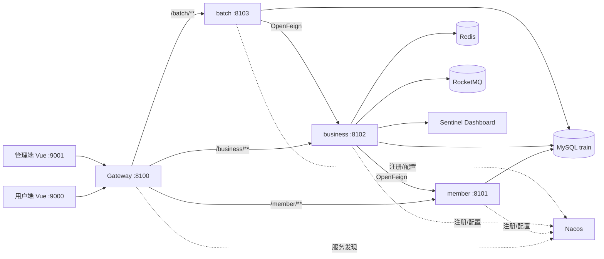
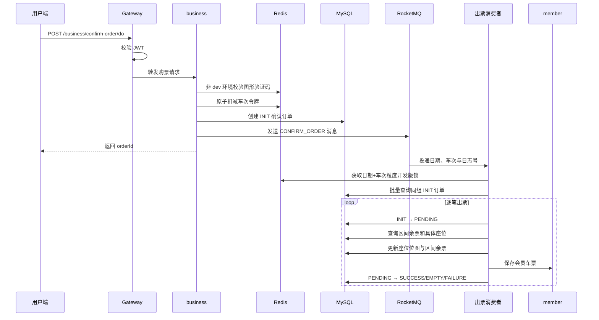
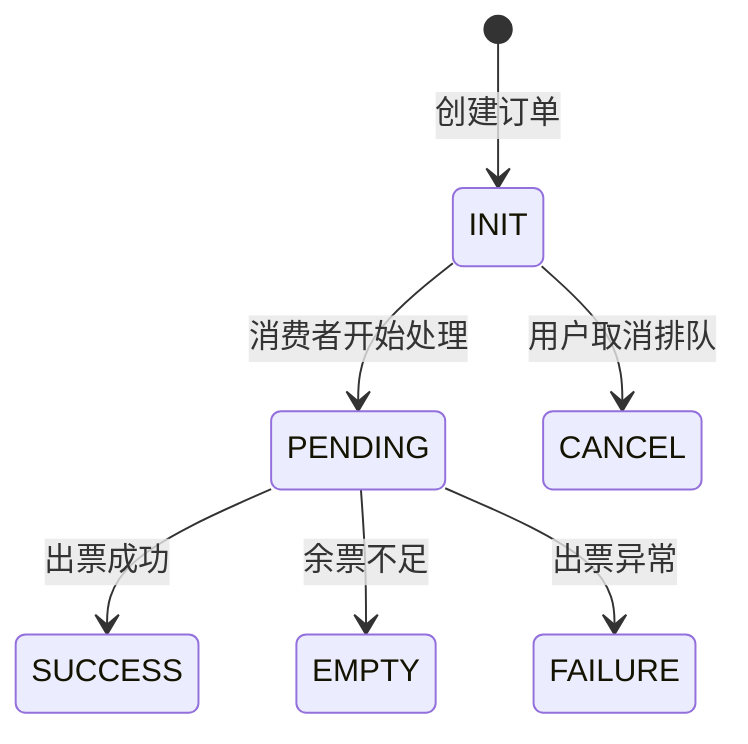
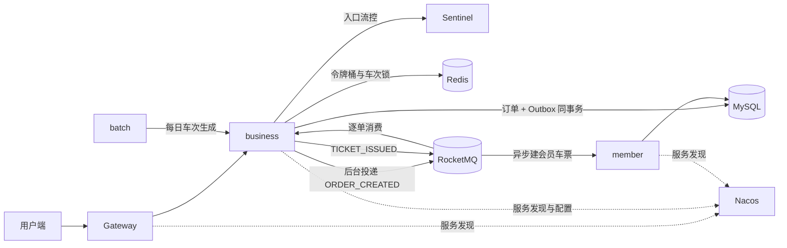

<<<<<<< HEAD
# 微服务售票系统｜高并发购票场景实践


一个面向火车票查询与高并发购票场景的 Spring Cloud 微服务项目，重点展示从请求准入、消息排队到区间库存与成组选座的完整链路。系统覆盖会员登录、乘客管理、车次与余票查询、验证码校验、购票排队、异步出票、座位选择、订单状态查询及每日车次数据生成。

项目重点实践了 RocketMQ 异步削峰、Redis 业务准入、车次粒度互斥、座位区间复用、Sentinel 流量保护以及 Nacos 服务注册与发现。

> 本项目用于后端技术学习与工程实践，尚未达到真实铁路售票系统或生产交易系统的安全、可靠性和合规要求。

## 项目亮点

- **微服务拆分**：按网关、会员、业务、批处理和公共组件拆分模块，通过 Nacos 完成服务注册与发现。
- **异步出票**：订单先以 `INIT` 状态落库，再投递 RocketMQ，由消费者后台完成查余票、选座和出票。
- **流量分层保护**：非 dev 环境图形验证码、Sentinel 接入、Redis 令牌大闸和车次粒度锁共同减少无效请求对数据库的冲击。
- **区间座位模型**：每个物理座位使用二进制字符串记录不同站段的占用状态，支持不重叠区间复用。
- **排队状态机**：订单在 `INIT / PENDING / SUCCESS / FAILURE / EMPTY / CANCEL` 之间流转，前端可轮询排队状态。
- **动态车次数据**：支持通过 Quartz 创建定时任务；`DailyTrainJob` 执行时生成当前日期后第 15 天的每日车次、车站、车厢、座位、区间余票和令牌数据。
- **双端前端**：提供用户端和管理端 Vue 应用，覆盖购票流程与基础数据管理。

## 技术栈

| 分类 | 技术 |
|---|---|
| 后端基础 | Java 17、Spring Boot 3.5、Spring MVC、Spring AOP |
| 微服务 | Spring Cloud Gateway、OpenFeign、Nacos、Spring Cloud LoadBalancer |
| 数据访问 | MyBatis、PageHelper、MySQL 8 |
| 缓存与并发 | Redis、Redisson 依赖、ThreadLocal |
| 消息队列 | RocketMQ |
| 流量治理 | Sentinel、Nacos 数据源 |
| 任务调度 | Quartz |
| 身份认证 | JWT、Gateway GlobalFilter、MVC Interceptor |
| 前端 | Vue 3、Vite、Ant Design Vue、Pinia、Axios |
| 工程辅助 | Maven、MyBatis Generator、Freemarker |

## 实现状态

| 能力 | 当前状态 |
|---|---|
| RocketMQ 订单排队 | 已实现；消息按日期和车次唤醒批量拉单 |
| 座位区间位图 | 已实现 |
| 相对选座偏移 | 已实现 |
| Redis 令牌大闸 | 已实现；不是按时间补充的标准 Token Bucket |
| 车次粒度锁 | 当前分支为 `SET NX + 10s TTL` 的开发版实现 |
| Redisson `RLock` | 已引入依赖，尚未在当前车次锁代码中启用 |
| Sentinel | 客户端、注解与 Nacos 数据源已接入；规则文件不在仓库中 |
| Seata 分布式事务 | 配置或注解处于注释/未完整启用状态 |
| Outbox、订单级消费幂等 | 规划中，尚未实现 |
| 数据库初始化与自动化测试 | 尚待补充 |

## 系统架构



## 模块说明

```text
train/
├─ gateway/     API 网关、JWT 前置校验、服务路由
├─ member/      会员登录、乘客管理、会员车票
├─ business/    车次、库存、验证码、购票、选座与出票
├─ batch/       Quartz 任务管理、每日车次数据生成
├─ common/      通用响应、异常处理、JWT、日志、上下文与雪花 ID
├─ generator/   MyBatis/Freemarker 代码生成工具
├─ web/         用户端 Vue 应用
├─ admin/       管理端 Vue 应用
└─ http/        部分接口调试文件
```

## 核心购票链路



当前 RocketMQ 消息主要包含：

```json
{
  "date": "示意日期值",
  "trainCode": "G123",
  "logId": "trace-id"
}
```

> 上述 JSON 为便于阅读的结构示意。当前代码直接通过 Fastjson 序列化 `java.util.Date`，实际线格式应以运行时抓取结果为准。

完整订单已经保存在 MySQL。消息更接近“某日某车次存在待处理订单”的唤醒通知；消费者使用日期、车次和 `INIT` 状态批量拉取订单，每批取 5 条并循环，直到这一组没有 `INIT` 订单。

## 座位区间复用

每个 `DailyTrainSeat` 代表一个确定的物理座位：

```text
日期 + 车次 + 车厢号 + 排号 + 列号
```

`sell` 字符串记录该座位在各相邻站段的占用情况。假设列车经过 6 个站，则有 5 个站间区间：

```text
站点：S0 ---- S1 ---- S2 ---- S3 ---- S4 ---- S5
位号：     0       1       2       3       4
```

例如：

```text
sell = 10000
```

表示该座位的 `S0 → S1` 已售，其余区间仍可售。用户购买 `S1 → S4` 时，目标掩码为 `01110`：

```text
原状态：10000
新购买：01110
按位或：11110
```

两个行程首尾相接但不重叠，因此可以复用同一个座位；如果目标区间中已有任意一位为 `1`，则该座位不可选择。

## 相对选座

前端不会直接指定真实车厢和排号，而是提供两排相对座位模板。

一等座布局：

```text
第 1 排：A1 C1 | D1 F1
第 2 排：A2 C2 | D2 F2
```

按照行优先展开：

```text
[A1, C1, D1, F1, A2, C2, D2, F2]
```

选择 `C1、D2` 时，它们的下标为 `1、6`，相对于第一个座位的偏移为 `[0,5]`。后端以 C 列为锚点，在真实车厢中依次尝试：

```text
1C + 2D
2C + 3D
3C + 4D
...
```

只有整组座位在目标乘车区间内都可用，才会加入最终出票结果。该算法依赖座位按照 `carriage_seat_index` 稳定排序，并使用左闭右开的 `[startIndex, endIndex)` 区间。

## 订单状态



## 端口

| 服务 | 端口 | Context Path |
|---|---:|---|
| Gateway | 8100 | `/` |
| member | 8101 | `/member` |
| business | 8102 | `/business` |
| batch | 8103 | `/batch` |
| 用户端 | 9000 | `/` |
| 管理端 | 9001 | `/` |
| Nacos | 8848 | — |
| RocketMQ NameServer | 9876 | — |
| Sentinel Dashboard | 8090 | — |

## 本地运行

> **可运行性说明**：当前仓库尚未提供业务表、基础车次数据和 Quartz 表的统一 SQL 初始化脚本，因此不能从空数据库直接一键启动。下面步骤适用于已经准备好 `train` 数据库结构和基础数据的本地环境；首次访问者需要先自行补齐数据库初始化。

### 环境要求

- JDK 17
- Maven 3.9+
- Node.js `^20.19.0` 或 `>=22.12.0`
- MySQL 8
- Redis
- Nacos
- RocketMQ
- Sentinel Dashboard（需要查看或配置限流时）

### 1. 克隆项目

```bash
git clone https://github.com/yali325/train-12306-system.git
cd train-12306-system
```

### 2. 准备基础设施

默认本地连接：

| 组件 | 默认地址 |
|---|---|
| MySQL | `localhost:3306/train` |
| Redis | `localhost:6379` |
| Nacos | `localhost:8848` |
| RocketMQ NameServer | `localhost:9876` |
| Sentinel Dashboard | `localhost:8090` |

创建 `train` 数据库，并准备项目所需表结构与基础车次数据。当前仓库尚未提供统一的数据库初始化和迁移脚本，因此全新环境需要自行初始化数据库。

如果启用 `batch` 的数据库型 Quartz 调度，还需要准备 Quartz 所需表；仓库中的默认 Job Bean 声明已注释，需要通过管理端或 `/batch/admin/job/add` 创建 `com.yali.batch.job.DailyTrainJob` 定时任务后才会周期执行。

### 3. 修改配置

根据本机环境修改：

```text
member/src/main/resources/application.yml
business/src/main/resources/application.yml
batch/src/main/resources/application.yml
gateway/src/main/resources/application.yml
```

至少需要确认：

- MySQL URL、用户名与密码
- Redis 地址
- Nacos 地址及 namespace
- RocketMQ NameServer 地址
- Sentinel Dashboard 地址

两个前端通过 `VITE_SERVER` 读取网关地址，可分别创建 `web/.env.local` 和 `admin/.env.local`：

```dotenv
VITE_SERVER=http://localhost:8100
```

> 提交到公开仓库前，请将数据库密码、JWT 密钥和环境专属 namespace 移出源码，改用环境变量、独立配置文件或秘密管理服务。

### 4. 构建后端

```bash
mvn clean package -DskipTests
```

### 5. 启动后端服务

先启动 MySQL、Redis、Nacos 和 RocketMQ，再依次运行：

```text
com.yali.member.MemberApplication
com.yali.business.BusinessApplication
com.yali.batch.BatchApplication
com.yali.gateway.GatewayApplication
```

也可以运行各模块打包后的 JAR。

### 6. 启动用户端

```bash
cd web
npm ci
npm run dev
```

访问：<http://localhost:9000>

### 7. 启动管理端

```bash
cd admin
npm ci
npm run dev
```

访问：<http://localhost:9001>

## 核心代码导航

| 主题 | 文件 |
|---|---|
| 购票入口与验证码 | [`ConfirmOrderController.java`](business/src/main/java/com/yali/business/controller/ConfirmOrderController.java) |
| 订单落库与 MQ 生产 | [`BeforeConfirmOrderService.java`](business/src/main/java/com/yali/business/service/BeforeConfirmOrderService.java) |
| MQ 消费者 | [`ConfirmOrderConsumer.java`](business/src/main/java/com/yali/business/mq/ConfirmOrderConsumer.java) |
| 锁、批量拉单与选座 | [`ConfirmOrderService.java`](business/src/main/java/com/yali/business/service/ConfirmOrderService.java) |
| 座位和区间余票落库 | [`AfterConfirmOrderService.java`](business/src/main/java/com/yali/business/service/AfterConfirmOrderService.java) |
| Redis 令牌大闸 | [`SkTokenService.java`](business/src/main/java/com/yali/business/service/SkTokenService.java) |
| 区间余票更新 SQL | [`DailyTrainTicketMapperCust.xml`](business/src/main/resources/mapper/cust/DailyTrainTicketMapperCust.xml) |
| 每日车次生成 | [`DailyTrainService.java`](business/src/main/java/com/yali/business/service/DailyTrainService.java) |
| Quartz 任务 | [`DailyTrainJob.java`](batch/src/main/java/com/yali/batch/job/DailyTrainJob.java) |
| Gateway 登录过滤 | [`LoginMemberFilter.java`](gateway/src/main/java/com/yali/gateway/config/LoginMemberFilter.java) |

## 压测记录

历史 JMeter 购票接口测试记录：

| 指标 | 结果 |
|---|---:|
| 样本数 | 4,820 |
| 吞吐量 | 约 171.9 req/s |
| 平均响应时间 | 571 ms |
| P95 | 1,432 ms |
| 错误率 | 约 2.07% |

这些数据来自特定本地测试环境，仓库当前未包含 `.jmx` 脚本、硬件说明和原始结果文件，因此不应视为生产 SLA。购票接口返回订单号也不代表后台已经完成出票。

## 当前实现边界

- 当前分支使用 Redis `SET NX + 10s TTL` 做车次粒度的开发版尽力互斥；没有 owner token、自动续期和安全解锁，处理超时后不能保证严格互斥。项目已引入 Redisson，后续可恢复为带 Watchdog 的 `RLock` 实现。
- 订单落库与 MQ 发送尚未通过 Outbox 或事务消息形成原子闭环。
- MQ 消息当前按日期和车次唤醒批量处理，不是一条消息严格绑定一个订单。
- 当前消费者调用的方法仍保留早期 JVM 异步方案的 `@Async` 注解，监听线程返回与实际出票结果没有严格绑定；接入 RocketMQ 后应移除该遗留注解。
- business 与 member 之间的会员车票写入尚未形成可靠事件和幂等闭环。
- Seata 相关配置和注解处于注释或未完整启用状态。
- 数据库初始化脚本、自动化测试和可复现压测材料仍需补充。
- 当前配置和权限逻辑仅适用于受信任的本地开发环境，禁止不经整改直接暴露到公网。

具体安全缺口包括：MySQL root 密码和 JWT 密钥硬编码、日志可能输出完整 token、Gateway 对部分管理和调试路径直接放行、宽松 CORS、dev 环境跳过验证码，以及订单状态查询和取消未按当前会员校验资源归属。

## 后续计划

- [ ] 使用 Redisson `RLock` 替换开发分支中的固定 TTL 锁。
- [ ] 移除 RocketMQ 消费链路遗留的 `@Async`，让消费确认与业务结果一致。
- [ ] 使用 Transactional Outbox 或 RocketMQ 事务消息解决订单与消息双写。
- [ ] 将消息调整为携带 `orderId`，通过条件状态迁移实现消费者幂等。
- [ ] 为座位、余票和订单更新补充本地事务与数据库条件更新。
- [ ] 增加超时 `PENDING` 订单恢复、重试、死信和补偿任务。
- [ ] 增加数据库初始化脚本、单元测试、并发集成测试和故障注入测试。
- [ ] 补充 Prometheus、链路追踪、MQ 积压与订单状态监控。
- [ ] 补充可复现的 JMeter 脚本、环境说明和压测报告。

## 声明

本仓库用于学习和展示 Java 后端、微服务与高并发交易链路设计。项目中的票价、车次、验证码、排队和库存规则均为模拟实现，不代表真实铁路业务规则。

## 作者

- GitHub：[@yali325](https://github.com/yali325)
=======
# 微服务高性能售票系统

基于 Spring Cloud 的车次查询与购票实践项目，包含会员、业务、网关和批处理服务。系统将请求受理与出票分开：购票请求先生成订单，后台通过 RocketMQ 完成选座和库存更新；座位位图支持不重叠站段复用。

## 核心实现

- **分层准入**：购票入口接入 Sentinel 流控资源；Redis Lua 令牌桶以日期、车次为 key，原子计算补充和扣减令牌。仓库中的 `10000 单/秒、桶容量 5000` 是容量测试参数，不是经过校准的生产阈值。
- **可靠投递**：请求 ID、`INIT` 订单与 `ORDER_CREATED` Outbox 事件在同一 MySQL 事务中写入。后台线程领取事件、向 RocketMQ 投递并记录 Broker 确认结果；发送与标记不能原子化，消费者通过状态判断处理重复消息。
- **逐单出票**：一条购票消息对应一笔订单。消费者按订单自身的日期和车次等待 Redisson RLock；同车次串行，不同车次可以并发。座位位图、区间余票、订单状态和 `TICKET_ISSUED` Outbox 在 business 本地事务中提交，座位旧值条件更新作为最后防线。
- **会员车票同步**：business 出票成功后投递 `TICKET_ISSUED`，member 异步保存车票，并以订单与乘客唯一键处理重复事件。
- **座位区间复用**：`daily_train_seat.sell` 的每一位对应一个站间区段；已售区段冲突时不可选择，未重叠区段可复用。同车厢座位查询使用 `(date, train_code, carriage_index, carriage_seat_index)` 复合索引。



### 一次购票如何执行

1. Gateway 校验登录身份；business 校验验证码（开发环境可跳过），入口经过 Sentinel 和按日期、车次的 Redis 令牌桶。
2. 按 `requestId` 查询重复提交。新请求在本地事务中同时写入 `INIT` 订单、请求键与 `ORDER_CREATED` Outbox，HTTP 返回订单 ID，表示**已受理**。
3. Outbox 投递器以短事务领取待发事件，向 `CONFIRM_ORDER` 投递；Broker 确认后标记 `SENT`，失败则退避重试。
4. 消费者按消息中的 `orderId` 精确查订单，等待同日期、车次的 RLock。终态订单直接确认；`INIT` 订单在锁内选座，并用本地事务更新座位位图、受影响区间余票、订单状态和会员车票事件。
5. member 消费 `TICKET_ISSUED` 保存车票。用户可以轮询订单状态；`PENDING` 与 `SUCCESS` 在同一个出票事务内更新，正常情况下主要看到 `INIT → SUCCESS`，无票时为 `EMPTY`。

## 技术栈与模块

Java 17、Spring Boot 3.5、Spring Cloud Gateway / OpenFeign、MyBatis、MySQL 8、Redis / Redisson、RocketMQ、Sentinel、Nacos、Quartz、Vue 3。

| 模块 | 用途 |
| --- | --- |
| `gateway` | JWT 校验、服务路由 |
| `business` | 车次、余票、购票、选座、Outbox 投递与出票消费 |
| `member` | 会员、乘客和异步生成的车票 |
| `batch` | Quartz 调度与每日车次生成 |
| `common` | 通用响应、异常、上下文和公共 DTO |
| `web` / `admin` | 用户端和管理端 Vue 页面 |
| `generator` | MyBatis 代码生成工具 |

## 本地启动

需要 JDK 17、Maven、Node.js、MySQL 8、Redis、Nacos 和 RocketMQ。按本机环境检查四个后端模块的 `src/main/resources/application.yml`，包括数据库、Redis、Nacos 和 RocketMQ 地址。配置文件含本地开发值；用于公开部署前应改为外部配置或环境变量，不要直接沿用。

1. 创建空的 `train` 数据库，**只在空库**执行 `sql/member.sql`、`sql/business.sql`、`sql/batch.sql`。这些基础脚本包含 `DROP TABLE`，会删除旧数据。
2. 新库随后执行 `sql/ticket_order_id.sql`、`sql/purchase_admission.sql`、`sql/outbox_event.sql`。`business.sql` 已包含座位查询索引，**新库无需再执行** `daily_train_seat_lookup_index.sql`。
3. **已有旧版数据库**应按实际表结构分别执行上述增量脚本；`ticket_order_id.sql` 与 `daily_train_seat_lookup_index.sql` 是一次性 `ALTER TABLE`，重复执行会因列或索引已存在而失败。不要在现有库上重跑基础脚本。
4. 启动 MySQL、Redis、Nacos、RocketMQ，再启动 `member`、`business`、`batch`、`gateway`。管理端录入基础车站、车次、车厢和座位后，生成指定日期的每日车次、车站、车厢、座位及区间余票。

默认本地端口：Gateway `8100`、member `8101`、business `8102`、batch `8103`。用户端和管理端分别位于 `web/`、`admin/`，各自运行 `npm ci` 与 `npm run dev`。首次运行还需要准备 Nacos 配置和相应的 Sentinel 规则；仓库不附带本地测试所用的动态规则数据。

## SQL 文件说明

| 文件 | 用途 |
| --- | --- |
| `batch.sql` | Quartz 调度表基础结构 |
| `member.sql` | 会员、乘客和车票基础表 |
| `business.sql` | 车次、每日座位、区间余票和订单等基础表；已包含座位查询索引 |
| `ticket_order_id.sql` | 给已有 `ticket` 表增加可空 `order_id` 和 `(order_id, passenger_id)` 唯一键 |
| `purchase_admission.sql` | 创建 `purchase_request`，以会员 ID＋请求 ID 保证入口重复提交幂等 |
| `outbox_event.sql` | 创建 `outbox_event`，保存购票与会员车票事件的投递状态、租约和重试时间 |
| `daily_train_seat_lookup_index.sql` | 给**已有** `daily_train_seat` 表补按车次、车厢、座序查询的复合索引 |

## 本地压测结果

在同一台本地环境中，JMeter 使用 400 线程、5 秒启动、每线程 10 次，共 4000 个购票请求；接口**受理**吞吐约 **449 req/s**，平均响应 **528 ms**、P95 **752 ms**、JMeter 错误率 **0%**。4000 笔订单最终均成功出票，全部完成约 **5 分 39 秒**。另以 400 个全程一等座请求竞争当时剩余的 250 张票，最终 250 笔成功、150 笔无票，未观察到超卖或重复占用全程座位。

上述数字属于特定本地环境；HTTP 受理吞吐不是实际出票吞吐。测试使用放宽的入口限流参数，没有验证 Sentinel 与令牌桶的阈值效果。`performance/` 包含本地 JMeter 结果和测试数据，已从 Git 提交中排除。

## 当前边界

- 同一日期、车次的出票仍由一把 RLock 串行处理，热点车次的最终出票速度低于接口受理速度；现阶段没有已受理订单数量的硬上限。
- Outbox 和 MQ 采用至少一次处理思路；长期 `INIT`、死信消息和历史异常状态仍需要监控及恢复流程。不能宣称端到端 exactly once。
- 250 张余票的售罄验证是在本地当前实例完成的，尚未覆盖多实例、Redis 故障和锁失效等场景。
- Sentinel 流控资源及 Nacos 数据源已接入，但本地容量测试不证明运行时流控阈值有效，也不代表已验证熔断规则。

## 代码入口

- 购票接口：[ConfirmOrderController](business/src/main/java/com/yali/business/controller/ConfirmOrderController.java)
- Redis 令牌桶：[PurchaseRateService](business/src/main/java/com/yali/business/service/PurchaseRateService.java)、[Lua 脚本](business/src/main/resources/lua/purchase_rate.lua)
- 订单与 Outbox 同事务：[OrderCreateTxService](business/src/main/java/com/yali/business/service/OrderCreateTxService.java)
- Outbox 投递：[OutboxRelayService](business/src/main/java/com/yali/business/service/OutboxRelayService.java)
- 购票消费者与选座：[ConfirmOrderConsumer](business/src/main/java/com/yali/business/mq/ConfirmOrderConsumer.java)、[ConfirmOrderService](business/src/main/java/com/yali/business/service/ConfirmOrderService.java)
- 出票事务：[AfterConfirmOrderService](business/src/main/java/com/yali/business/service/AfterConfirmOrderService.java)
- 会员车票消费者：[TicketIssuedConsumer](member/src/main/java/com/yali/member/mq/TicketIssuedConsumer.java)
>>>>>>> d16a315 (完善购票可靠性与高并发出票链路)
