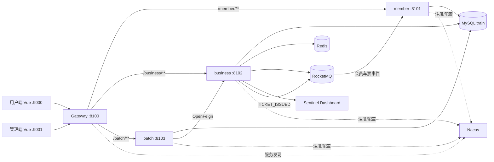
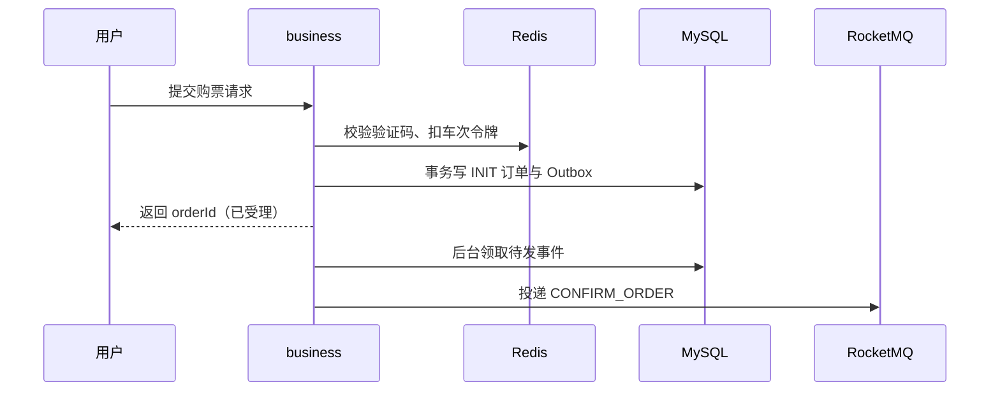
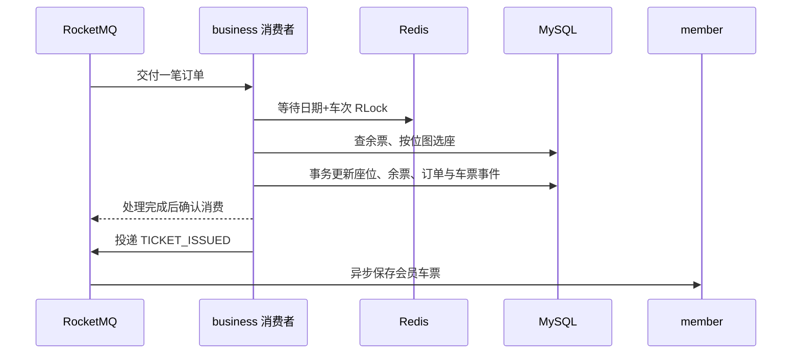
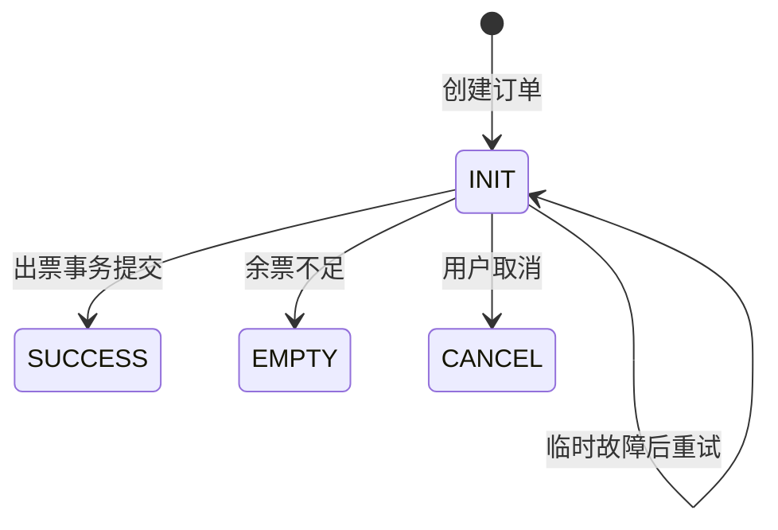

# 微服务售票系统｜高并发购票场景实践


一个面向火车票查询与高并发购票场景的 Spring Cloud 微服务项目，覆盖会员登录、乘客管理、车次与余票查询、验证码校验、订单异步受理、后台出票、座位选择、订单状态查询及每日车次数据生成。

项目重点实践了订单与 Outbox 同事务、RocketMQ 逐单消费、Redis Lua 令牌桶、Redisson 车次锁、座位区间复用、Sentinel 入口流控以及 Nacos 服务注册与发现。

> 本项目用于后端技术学习与工程实践，尚未达到真实铁路售票系统或生产交易系统的安全、可靠性和合规要求。

## 项目亮点

- **微服务拆分**：按网关、会员、业务、批处理和公共组件拆分模块，通过 Nacos 完成服务注册与发现。
- **可靠异步出票**：`INIT` 订单与待发事件同事务落库，Outbox 后台投递 RocketMQ；消费者按 `orderId` 一单一消息出票。
- **流量分层保护**：非 dev 环境图形验证码、Sentinel 入口资源和按日期车次的 Redis Lua 令牌桶控制请求进入；当前压测参数不代表生产限流阈值。
- **区间座位模型**：每个物理座位使用二进制字符串记录不同站段的占用状态，支持不重叠区间复用。
- **库存一致性**：Redisson RLock 按日期车次串行选座，本地事务更新座位、区间余票和订单；座位旧值条件更新防止旧快照覆盖。
- **动态车次数据**：支持通过 Quartz 创建定时任务，生成指定日期的每日车次、车站、车厢、座位和区间余票。
- **双端前端**：提供用户端和管理端 Vue 应用，覆盖购票流程与基础数据管理。

## 技术栈

| 分类 | 技术 |
|---|---|
| 后端基础 | Java 17、Spring Boot 3.5、Spring MVC、Spring AOP |
| 微服务 | Spring Cloud Gateway、OpenFeign、Nacos、Spring Cloud LoadBalancer |
| 数据访问 | MyBatis、PageHelper、MySQL 8 |
| 缓存与并发 | Redis Lua、Redisson RLock、ThreadLocal |
| 消息队列 | RocketMQ |
| 流量治理 | Sentinel、Nacos 数据源 |
| 任务调度 | Quartz |
| 身份认证 | JWT、Gateway GlobalFilter、MVC Interceptor |
| 前端 | Vue 3、Vite、Ant Design Vue、Pinia、Axios |
| 工程辅助 | Maven、MyBatis Generator、Freemarker |

## 实现状态

| 能力 | 当前状态 |
|---|---|
| RocketMQ 逐单出票 | 已实现；消息携带 `orderId`，消费者同步处理并按终态幂等跳过 |
| 座位区间位图 | 已实现 |
| 相对选座偏移 | 已实现 |
| Redis 令牌桶 | 已实现；Redis Lua 按日期车次及 Redis 时间原子补充、扣减令牌 |
| 车次粒度锁 | 已使用 Redisson RLock；同车次等锁串行出票，其他车次可并发 |
| Sentinel | 购票入口资源、blockHandler 和 Nacos 规则数据源已接入 |
| Seata 分布式事务 | 配置或注解处于注释/未完整启用状态 |
| Outbox、订单级消费幂等 | 已实现；事件至少一次投递，终态订单重复消息直接确认 |
| 数据库初始化与自动化测试 | 基础及增量 SQL 已提供；自动化测试和故障注入仍待补充 |

## 系统架构



## 模块说明

```text
train/
├─ gateway/     API 网关、JWT 前置校验、服务路由
├─ member/      会员登录、乘客管理、会员车票
├─ business/    车次、库存、验证码、购票、选座与出票
├─ batch/       Quartz 任务管理、每日车次数据生成
├─ common/      通用响应、异常处理、JWT、日志、上下文与雪花 ID
├─ generator/   MyBatis/Freemarker 代码生成工具
├─ web/         用户端 Vue 应用
├─ admin/       管理端 Vue 应用
└─ http/        部分接口调试文件
```

## 核心购票链路

**订单受理与投递**：Gateway 校验 JWT 后将请求转给 business，购票入口还受 Sentinel 流控保护。



**逐单出票与会员车票**：MQ 消息携带 `orderId`，一条消息只处理一笔订单。



当前 RocketMQ 消息主要包含：

```json
{
  "eventId": 123456789,
  "orderId": 987654321,
  "date": "示意日期值",
  "trainCode": "G9001",
  "logId": "trace-id"
}
```

> 上述 JSON 为便于阅读的结构示意。当前代码直接通过 Fastjson 序列化 `java.util.Date`，实际线格式应以运行时抓取结果为准。

完整订单已经保存在 MySQL，消息通过 `orderId` 精确定位一笔。Outbox 投递允许重复消息；消费者拿锁后重查订单，已到 `SUCCESS / EMPTY / CANCEL / FAILURE` 等终态就直接确认，不重复扣库存。当前没有按日期车次批量拉取 `INIT` 订单的循环。

## 座位区间复用

每个 `DailyTrainSeat` 代表一个确定的物理座位：

```text
日期 + 车次 + 车厢号 + 排号 + 列号
```

`sell` 字符串记录该座位在各相邻站段的占用情况。假设列车经过 6 个站，则有 5 个站间区间：

```text
站点：S0 ---- S1 ---- S2 ---- S3 ---- S4 ---- S5
位号：     0       1       2       3       4
```

例如：

```text
sell = 10000
```

表示该座位的 `S0 → S1` 已售，其余区间仍可售。用户购买 `S1 → S4` 时，目标掩码为 `01110`：

```text
原状态：10000
新购买：01110
按位或：11110
```

两个行程首尾相接但不重叠，因此可以复用同一个座位；如果目标区间中已有任意一位为 `1`，则该座位不可选择。

## 相对选座

前端不会直接指定真实车厢和排号，而是提供两排相对座位模板。

一等座布局：

```text
第 1 排：A1 C1 | D1 F1
第 2 排：A2 C2 | D2 F2
```

按照行优先展开：

```text
[A1, C1, D1, F1, A2, C2, D2, F2]
```

选择 `C1、D2` 时，它们的下标为 `1、6`，相对于第一个座位的偏移为 `[0,5]`。后端以 C 列为锚点，在真实车厢中依次尝试：

```text
1C + 2D
2C + 3D
3C + 4D
...
```

只有整组座位在目标乘车区间内都可用，才会加入最终出票结果。该算法依赖座位按照 `carriage_seat_index` 稳定排序，并使用左闭右开的 `[startIndex, endIndex)` 区间。

## 订单状态



出票事务内部曾把订单从 `INIT` 更新为 `PENDING`，同一事务再写 `SUCCESS`；事务提交前外部通常看不到 `PENDING`。`FAILURE` 是保留的状态枚举，当前正常购票链路不以它表示暂时性消费失败。

## 端口

| 服务 | 端口 | Context Path |
|---|---:|---|
| Gateway | 8100 | `/` |
| member | 8101 | `/member` |
| business | 8102 | `/business` |
| batch | 8103 | `/batch` |
| 用户端 | 9000 | `/` |
| 管理端 | 9001 | `/` |
| Nacos | 18848（当前本地配置） | — |
| RocketMQ NameServer | 9876 | — |
| Sentinel Dashboard | 8090 | — |

## 本地运行

> **可运行性说明**：仓库提供基础表与本轮改造所需的增量 SQL，但不包含基础车站、车次、车厢、座位数据和 Nacos 动态规则。需要在管理端录入基础数据并生成每日数据后，才能完成购票流程。

### 环境要求

- JDK 17
- Maven 3.9+
- Node.js `^20.19.0` 或 `>=22.12.0`
- MySQL 8
- Redis
- Nacos
- RocketMQ
- Sentinel Dashboard（需要查看或配置限流时）

### 1. 克隆项目

```bash
git clone https://github.com/yali325/train-12306-system.git
cd train-12306-system
```

### 2. 准备基础设施

默认本地连接：

| 组件 | 默认地址 |
|---|---|
| MySQL | `localhost:3306/train` |
| Redis | `localhost:6379` |
| Nacos | `localhost:18848`（当前本地配置，可自行修改） |
| RocketMQ NameServer | `localhost:9876` |
| Sentinel Dashboard | `localhost:8090` |

创建 `train` 数据库。以下基础脚本**包含 `DROP TABLE`，仅用于空库初始化，不能对已有数据的库重跑**：

| 基础脚本 | 创建内容 |
|---|---|
| `sql/member.sql` | 会员、乘客、会员车票基础表 |
| `sql/business.sql` | 车次、每日座位、区间余票、确认订单等业务表；已含座位查询复合索引 |
| `sql/batch.sql` | Quartz 调度表 |

空库执行基础脚本后，再执行 `sql/ticket_order_id.sql`（给会员车票增加 `order_id` 与唯一键）、`sql/purchase_admission.sql`（请求幂等表）、`sql/outbox_event.sql`（事务消息表）。`sql/daily_train_seat_lookup_index.sql` 只用于**已有旧版业务表**补座位索引；新库的 `business.sql` 已包含同名索引，不要重复执行。对已有库只按实际表结构执行缺失的增量脚本，其中 `ALTER TABLE` 脚本只能执行一次。`sql/` 中没有基础车次数据。

如果启用 `batch` 的数据库型 Quartz 调度，需要上述 `batch.sql`；仓库中的默认 Job Bean 声明已注释，需要通过管理端或 `/batch/admin/job/add` 创建 `com.yali.batch.job.DailyTrainJob` 定时任务后才会周期执行。

### 3. 修改配置

根据本机环境修改：

```text
member/src/main/resources/application.yml
business/src/main/resources/application.yml
batch/src/main/resources/application.yml
gateway/src/main/resources/application.yml
```

至少需要确认：

- MySQL URL、用户名与密码
- Redis 地址
- Nacos 地址及 namespace
- RocketMQ NameServer 地址
- Sentinel Dashboard 地址及 Nacos 中实际使用的流控规则
- `business` 的 `purchase.admission` 参数；仓库中的 `10000 单/秒、桶容量 5000` 仅用于容量压测

两个前端通过 `VITE_SERVER` 读取网关地址，可分别创建 `web/.env.local` 和 `admin/.env.local`：

```dotenv
VITE_SERVER=http://localhost:8100
```

> 提交到公开仓库前，请将数据库密码、JWT 密钥和环境专属 namespace 移出源码，改用环境变量、独立配置文件或秘密管理服务。

### 4. 构建后端

```bash
mvn clean package -DskipTests
```

### 5. 启动后端服务

先启动 MySQL、Redis、Nacos 和 RocketMQ，再依次运行：

```text
com.yali.member.MemberApplication
com.yali.business.BusinessApplication
com.yali.batch.BatchApplication
com.yali.gateway.GatewayApplication
```

也可以运行各模块打包后的 JAR。

### 6. 启动用户端

```bash
cd web
npm ci
npm run dev
```

访问：<http://localhost:9000>

### 7. 启动管理端

```bash
cd admin
npm ci
npm run dev
```

访问：<http://localhost:9001>

## 核心代码导航

| 主题 | 文件 |
|---|---|
| 购票入口与验证码 | [`ConfirmOrderController.java`](business/src/main/java/com/yali/business/controller/ConfirmOrderController.java) |
| 订单与 Outbox 同事务 | [`OrderCreateTxService.java`](business/src/main/java/com/yali/business/service/OrderCreateTxService.java) |
| Outbox 后台投递 | [`OutboxRelayService.java`](business/src/main/java/com/yali/business/service/OutboxRelayService.java) |
| MQ 消费者 | [`ConfirmOrderConsumer.java`](business/src/main/java/com/yali/business/mq/ConfirmOrderConsumer.java) |
| 车次锁与选座 | [`ConfirmOrderService.java`](business/src/main/java/com/yali/business/service/ConfirmOrderService.java) |
| 座位和区间余票落库 | [`AfterConfirmOrderService.java`](business/src/main/java/com/yali/business/service/AfterConfirmOrderService.java) |
| Redis Lua 令牌桶 | [`PurchaseRateService.java`](business/src/main/java/com/yali/business/service/PurchaseRateService.java)、[`purchase_rate.lua`](business/src/main/resources/lua/purchase_rate.lua) |
| 会员车票事件消费 | [`TicketIssuedConsumer.java`](member/src/main/java/com/yali/member/mq/TicketIssuedConsumer.java) |
| 区间余票更新 SQL | [`DailyTrainTicketMapperCust.xml`](business/src/main/resources/mapper/cust/DailyTrainTicketMapperCust.xml) |
| 每日车次生成 | [`DailyTrainService.java`](business/src/main/java/com/yali/business/service/DailyTrainService.java) |
| Quartz 任务 | [`DailyTrainJob.java`](batch/src/main/java/com/yali/batch/job/DailyTrainJob.java) |
| Gateway 登录过滤 | [`LoginMemberFilter.java`](gateway/src/main/java/com/yali/gateway/config/LoginMemberFilter.java) |

## 压测记录

本地 G9001 购票接口压测：400 个 JMeter 线程，5 秒启动，每线程 10 次。以下是**接口受理**指标，不是出票吞吐：

| 指标 | 结果 |
|---|---:|
| 样本数 | 4,000 |
| 命令行受理吞吐 | 约 449 req/s |
| 平均响应时间 | 528 ms |
| P95 | 752 ms |
| JMeter 错误率 | 0% |

这 4000 笔订单最终均出票成功，全部完成约 5 分 39 秒。另以 400 次全程一等座请求竞争当时剩余的 250 张票，最终 250 笔成功、150 笔无票；在本地单实例测试中未观察到超卖或重复占座。接口返回订单号只表示受理，不能把 449 req/s 写成出票吞吐。测试用放宽的入口限流参数，未加入 Sentinel 和令牌桶的阈值效果。

## 当前实现边界

- Redisson RLock 保证当前正常路径同车次互斥；座位旧值条件更新与本地事务是数据库层防线。本地单实例售罄测试不覆盖多实例和锁失效场景。
- Outbox 保证订单与待发消息同事务落库，投递采用至少一次语义；Broker 已收但确认丢失时可能重复投递，不能宣称端到端 exactly once。
- MQ 一条消息精确处理一笔订单；同车次消息并发到达后在车次锁处等待，最终出票速度仍明显低于接口受理速度。当前没有已受理订单数的硬上限。
- member 车票使用独立事件异步创建和唯一键幂等；business `SUCCESS` 与会员车票可见之间仍有短暂延迟。
- Seata 相关配置和注解处于注释或未完整启用状态。
- 已提供基础与增量 SQL；自动化测试、故障注入和可复现压测材料仍需补充。
- 当前配置和权限逻辑仅适用于受信任的本地开发环境，禁止不经整改直接暴露到公网。

现有配置仍有本地明文凭据与环境专属地址；dev 环境跳过验证码，管理接口、CORS 和日志脱敏仍需部署前审查。订单状态查询与取消已经增加当前会员归属校验。

## 后续计划

- [ ] 为长期 `INIT`、死信消息和历史异常订单增加核对、告警与恢复流程。
- [ ] 基于持续负载测定 Sentinel 和令牌桶阈值，并限制消费者停机时仍不断受理的积压。
- [ ] 补充多实例、Redis 故障、重复投递等并发与故障注入测试。
- [ ] 逐步将本地凭据和环境配置迁出仓库，补充自动化测试与可复现压测材料。
- [ ] 补充 Prometheus、链路追踪、MQ 积压与订单状态监控。

## 声明

本仓库用于学习和展示 Java 后端、微服务与高并发交易链路设计。项目中的票价、车次、验证码、排队和库存规则均为模拟实现，不代表真实铁路业务规则。

## 作者

- GitHub：[@yali325](https://github.com/yali325)
